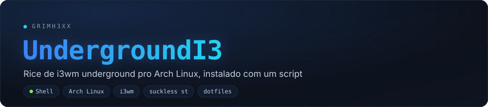
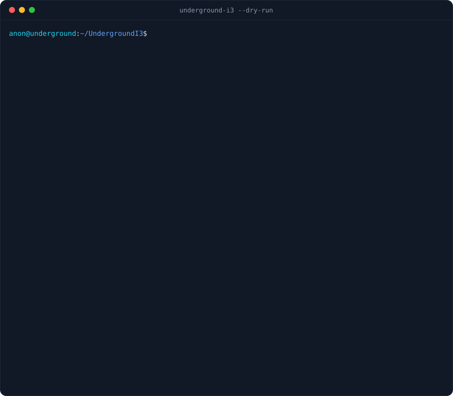

<div align="center">



**Underground i3wm setup for Arch Linux, installed with one script**
plain i3 · patched suckless st · rofi · i3blocks · pure bash, no dependencies

[](https://github.com/grimh3xx/i3wm-dotfile/actions)
[](https://github.com/grimh3xx/i3wm-dotfile/releases/latest)
[](LICENSE)


`grimh3xx` · [github.com/grimh3xx](https://github.com/grimh3xx)

</div>

<p align="center"></p>

---

An i3 setup **with no frills**: no polybar, no blur, no animations, no rounded corners. Near-black background, Arch blue, thin borders, and the terminal for everything.
A single bash script installs it. You pick components with **space** and confirm with **enter**. It shows the plan before touching anything, **backs up every file it replaces**, and can undo any run.

## What you get

- **i3**: Alt as mod, vim keys, small gaps that disappear with a single window, kanji workspaces 一 二 三, apps pinned to workspaces, unfocused windows dimmed by picom.
- **st (suckless)**: built from source with 8 patches: scrollback (with mouse), boxdraw, wide Nerd Font glyphs, Xresources colors with live reload, clipboard, `Ctrl+Shift+Enter` (new terminal in the same dir) and `Ctrl+Shift+U` (open links). Installed to `~/.local`, no root.
- **Bar (i3blocks)**:
  - a rotating Anonymous (2011) quote
  - now playing, network, disk, RAM
  - CPU (usage and temp), NVIDIA GPU (usage, temp and VRAM)
  - caffeine, microphone, CAPS/NUM
  - volume (scroll and click) and clock (click opens the calendar)
- **Dropdowns**: one key shows/hides a floating terminal app: Claude Code, btop, notes, lf, ncspot (Spotify), cava, weechat (IRC), newsboat (RSS).
- **rofi**:
  - one search for apps, open windows and commands
  - calculator, emoji, clipboard history (greenclip)
  - web search with prefixes
  - wallpaper picker with thumbnails
  - power menu, audio output switcher and a searchable keybind list
- **Lock**: pixelated screenshot with *expect us.* Locks by itself at 8 min and turns the screen off at 10.
- **fastfetch**: tree layout with a random logo (Anonymous mask / Linus / fsociety) drawn in Unicode blocks with chafa, so it works in st.
- **Shell**: zsh with a one-line starship prompt (`user@host ~ $`), fzf, zoxide, eza and bat.
- **One palette everywhere**: dunst, rofi, tmux, zathura, newsboat, ncspot, cava, mpv, lf and weechat all use `#101014` · `#1793d1` · `#22c7d8` · `#e06c75`.
- **Hardware**:
  - picks the monitor's native resolution and highest refresh rate
  - turns on G-Sync compatible on NVIDIA
  - finds the CPU sensor by itself (k10temp / zenpower / coretemp)

## Installer safety

- `--dry-run` prints every package, file and command **without changing anything**.
- Every file it replaces is first moved to `~/.local/state/underground-i3/backups/<run>/`. `restore` undoes a whole run, including removing what it created.
- Idempotent: running it again only changes what is missing or different.
- Never runs as root: `sudo` is only used for `pacman`, and AUR packages are built as your user.
- Log at `~/.local/state/underground-i3/underground-i3.log`.

## Install

```bash
sudo pacman -S --needed git
git clone https://github.com/grimh3xx/i3wm-dotfile && cd i3wm-dotfile

./underground-i3 --dry-run    # show the plan, change nothing
./underground-i3              # interactive installer
```

| Screen | Keys |
|------|--------|
| **Components** | `↑ ↓` / `j k` move · `space` toggle · `a` all · `↵` confirm · `q` quit |
| **Dotfiles** | `↑ ↓` choose **symlink** (`git pull` updates everything) or **copy** · `↵` |
| **Plan** | `↵` install · `q` cancel |

Then log out and pick **i3** in SDDM/LightDM/ly, or put `exec i3` in `~/.xinitrc` and run `startx`.

### Without the menu (scripts / CI)

```text
underground-i3 [options] [command]

  install [minimal|full]     minimal = core + st + dotfiles + wallpaper
                             full    = minimal + terminal apps + AUR + logos
  packages [SET...]          core apps aur nvidia | all
  dotfiles                   configs only (symlink or copy, with backup)
  st                         build and install the patched st
  assets                     fastfetch logos + default wallpaper
  doctor                     check the install (read-only)
  restore [ID|latest]        undo a run   (restore --list shows them)

  -n, --dry-run   -y, --yes   -c, --copy   --no-color   -V   -h
```

`make install` puts the command on your `PATH` (`~/.local/bin/underground-i3`).

## Keybinds

`Alt` is the mod key. **`Alt+/`** opens a list of every keybind, and `↵` runs the one you pick.

| Keys | Action |
|------|--------|
| `Alt+↵` | st · `Alt+Shift+↵` kitty · `Alt+Ctrl+↵` st + tmux |
| `Alt+d` | search apps, windows and commands |
| `Alt+o` | web search (`g` google · `aw` arch wiki · `aur` · `yt` · `gh` · `w` wikipedia · no prefix = duckduckgo) |
| `Alt+=` | calculator (`10 usd to eur`, `5 km to mi`…) · `Alt+.` emoji |
| `Alt+v` | clipboard history · `Alt+Shift+v` clear it |
| `Alt+c` · `t` · `n` | dropdown: Claude Code · btop · notes |
| `Alt+e` · `m` · `Shift+m` | dropdown: lf · ncspot · cava |
| `Alt+i` · `Shift+n` | dropdown: weechat · newsboat |
| `Alt+p` | audio output (headset, speakers, HDMI…) · `Alt+Shift+a` mute mic |
| `Alt+Shift+s` | screenshot with annotation (flameshot) · `Print` full screen · `Shift+Print` area |
| `Alt+Shift+w` | wallpaper picker |
| `Alt+Esc` | lock · `Alt+Shift+e` power menu |
| `Alt+Shift+Tab` | first empty workspace (`Alt+Ctrl+Tab` takes the window along) |
| `Alt+h j k l` | focus · `+Shift` move · `Alt+r` resize mode |
| `Alt+b` · `Alt+Shift+b` | split horizontal · vertical · `Alt+s` stacking · `Alt+w` tabbed · `Alt+x` toggle |
| `Alt+f` · `Alt+Space` · `Alt+g` | fullscreen · floating · gaps |
| `Alt+1..0` | workspace · `+Shift` move window |
| `Alt+Shift+x` · `Alt+Shift+r` | reload · restart i3 |

Workspaces: **1** terminal · **2** browser · **3** chat · **4** files · **5** games · **6** Spotify.

> With Alt as mod, i3 takes `Alt+key` away from apps (e.g. weechat's `Alt+1..9`; use `Ctrl+n`/`Ctrl+p` there).
> Prefer Super? Change `set $mod Mod1` to `Mod4` in `~/.config/i3/config`.

## Layout

```
underground-i3        main script (interactive installer + commands)
lib/
  common.sh           colors, logging, dry-run, prompts
  tui.sh              interactive cards (checklist / radio) in pure bash
  backup.sh           per-run backups + restore
  dotfiles.sh         symlink or copy, file by file
  packages.sh         pacman + paru/yay (AUR as your user)
  st.sh               fetches st 0.9.2, applies the patch, builds into ~/.local
  assets.sh           fastfetch logos + generated wallpaper
  doctor.sh           install check
packages/             core.txt · apps.txt · aur.txt · nvidia.txt
dotfiles/             mirror of $HOME (.config/i3, i3blocks, rofi, dunst-i3, picom-i3, fastfetch…)
st/                   st-underground-0.9.2.diff (every patch) · config.h · st-urls
assets/               logo.ans (grimh3xx pixel art) · logos/anon.png (CC BY-SA 4.0)
tools/
  gen_logo.py         builds assets/logo.ans from logo_grid.png
  gen_banner.py       builds docs/banner.svg
  record_demo.py      records docs/demo.svg by running the real installer
tests/run.sh          tests in a throwaway $HOME
```

## Notes

- **Spotify** (`Alt+m`) uses [ncspot](https://github.com/hrkfdn/ncspot), which needs **Spotify Premium**. Without Premium, install `spotify-launcher`; it opens on workspace 6.
- **Claude Code** (`Alt+c`) needs `claude` on your `PATH`.
- **The Linus and fsociety logos** are copyrighted and **are not in the repo**. `underground-i3 assets` asks before downloading them for personal use. See [assets/logos/CREDITS.md](assets/logos/CREDITS.md).
- **Monitor:** to force one, set `UG_OUTPUT=DP-2` and/or `UG_MODE=2560x1440` in `~/.xprofile`.

## Development

```sh
make lint       # shellcheck everything
make test       # install/restore in a throwaway $HOME (35+ checks)
make dry-run    # what "install full" would do
```

To re-record the demo: `pip install pyte fonttools brotli && python3 tools/record_demo.py docs/demo.svg`.

## Credits

[i3](https://i3wm.org) · [st](https://st.suckless.org) and its patch authors · [rofi](https://github.com/davatorium/rofi) · [i3blocks](https://github.com/vivien/i3blocks) · [fastfetch](https://github.com/fastfetch-cli/fastfetch) · [chafa](https://hpjansson.org/chafa/) · mask by nacreouss ([CC BY-SA 4.0](https://commons.wikimedia.org/wiki/File:Guy_fawkes_mask_by_nacreouss-d462juf.png)).

[MIT](LICENSE) license. st and its patches keep their own MIT/X license.

---

<div align="center">
<sub><code>[anon]</code> we do not forgive. we do not forget. <b>expect us.</b></sub><br>
<sub>© grimh3xx — <a href="https://github.com/grimh3xx">github.com/grimh3xx</a></sub>
</div>
